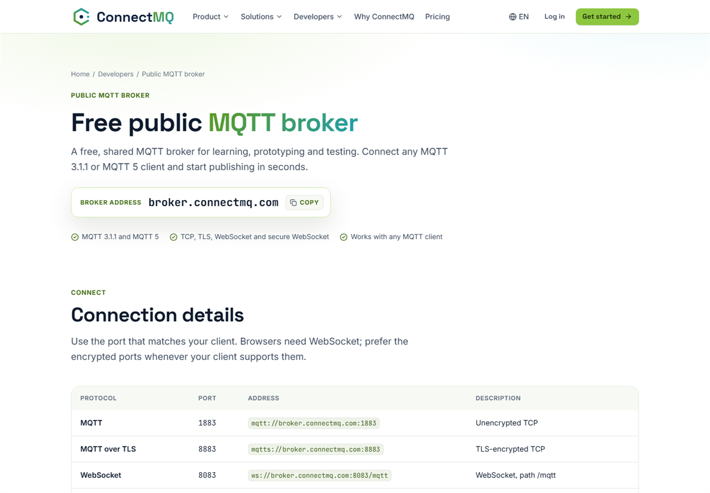

# MQTT Code Samples by ConnectMQ

[](https://connectmq.com/?utm_source=github&utm_medium=code-samples&utm_campaign=mqtt-code-samples&utm_content=root-badge)
[](https://connectmq.com/public-mqtt-broker/?utm_source=github&utm_medium=code-samples&utm_campaign=mqtt-code-samples&utm_content=root-badge)
[](LICENSE)

Ready-to-run MQTT examples for **12 languages and platforms**: connect, subscribe and publish a JSON sensor reading in a few lines of code.

Every example comes in two versions:

1. **`public-broker/`** — runs right away on the free public broker `broker.connectmq.com`, no account needed.
2. **`private-broker/`** — the same code on a secure private broker on **[ConnectMQ](https://connectmq.com/?utm_source=github&utm_medium=code-samples&utm_campaign=mqtt-code-samples&utm_content=root-intro)**: TLS, a username and password per device and per-topic access control.

> **[ConnectMQ](https://connectmq.com/?utm_source=github&utm_medium=code-samples&utm_campaign=mqtt-code-samples&utm_content=root-intro)** is a managed, serverless MQTT broker for IoT devices, apps and digital twins. Start on the **Serverless (Free)** plan — no credit card. 👉 **[Create your free broker](https://app.connectmq.com/signup?utm_source=github&utm_medium=code-samples&utm_campaign=mqtt-code-samples&utm_content=root-intro)**

<p align="center"><a href="https://connectmq.com/?utm_source=github&utm_medium=code-samples&utm_campaign=mqtt-code-samples&utm_content=root-hero"></a></p>

## Examples

| Language / platform | Library | Step-by-step guide |
| --- | --- | --- |
| [Python](python/) | paho-mqtt 2.x | [Guide](https://connectmq.com/code-samples/python/?utm_source=github&utm_medium=code-samples&utm_campaign=mqtt-code-samples&utm_content=root-python) |
| [Node.js](nodejs/) | MQTT.js 5 | [Guide](https://connectmq.com/code-samples/nodejs/?utm_source=github&utm_medium=code-samples&utm_campaign=mqtt-code-samples&utm_content=root-nodejs) |
| [ESP32](esp32/) | PubSubClient (Arduino) | [Guide](https://connectmq.com/code-samples/esp32/?utm_source=github&utm_medium=code-samples&utm_campaign=mqtt-code-samples&utm_content=root-esp32) |
| [Go](go/) | Eclipse Paho Go | [Guide](https://connectmq.com/code-samples/go/?utm_source=github&utm_medium=code-samples&utm_campaign=mqtt-code-samples&utm_content=root-go) |
| [CLI (mosquitto)](cli/) | mosquitto_pub / mosquitto_sub | [Guide](https://connectmq.com/code-samples/cli/?utm_source=github&utm_medium=code-samples&utm_campaign=mqtt-code-samples&utm_content=root-cli) |
| [Java](java/) | Eclipse Paho Java Client | [Guide](https://connectmq.com/code-samples/java/?utm_source=github&utm_medium=code-samples&utm_campaign=mqtt-code-samples&utm_content=root-java) |
| [C# (.NET)](csharp/) | MQTTnet 4 | [Guide](https://connectmq.com/code-samples/csharp/?utm_source=github&utm_medium=code-samples&utm_campaign=mqtt-code-samples&utm_content=root-csharp) |
| [Rust](rust/) | rumqttc | [Guide](https://connectmq.com/code-samples/rust/?utm_source=github&utm_medium=code-samples&utm_campaign=mqtt-code-samples&utm_content=root-rust) |
| [Dart (Flutter)](dart-flutter/) | mqtt_client | [Guide](https://connectmq.com/code-samples/dart-flutter/?utm_source=github&utm_medium=code-samples&utm_campaign=mqtt-code-samples&utm_content=root-dart-flutter) |
| [Swift / Kotlin](swift-kotlin/) | CocoaMQTT (iOS) · HiveMQ MQTT Client (Android) | [Guide](https://connectmq.com/code-samples/swift-kotlin/?utm_source=github&utm_medium=code-samples&utm_campaign=mqtt-code-samples&utm_content=root-swift-kotlin) |
| [Home Assistant](home-assistant/) | MQTT integration | [Guide](https://connectmq.com/code-samples/home-assistant/?utm_source=github&utm_medium=code-samples&utm_campaign=mqtt-code-samples&utm_content=root-home-assistant) |
| [Node-RED](node-red/) | mqtt in / mqtt out nodes | [Guide](https://connectmq.com/code-samples/node-red/?utm_source=github&utm_medium=code-samples&utm_campaign=mqtt-code-samples&utm_content=root-node-red) |

Each folder has its own README with install steps, both code versions and how to run them.

## Tutorials: complete projects

Beyond the basic examples, **[`tutorials/`](tutorials/)** holds the code of **58 step-by-step tutorials** from the [ConnectMQ blog](https://connectmq.com/blog/category/iot-tutorials/?utm_source=github&utm_medium=code-samples&utm_campaign=mqtt-code-samples&utm_content=root-tutorials): MQTT to databases (SQLite, MongoDB, InfluxDB, TimescaleDB), dashboards (Grafana, Streamlit, React, Vue, Angular), mobile and desktop apps, bots, device simulators, TLS, reconnect strategies and more — each ready to run on the free public broker and on your private ConnectMQ broker.

👉 **[Browse all tutorials](tutorials/)**

## Quick start: the free public broker

No sign-up, no setup — point any MQTT client at it:

| Protocol | URL |
| --- | --- |
| MQTT (TCP) | `mqtt://broker.connectmq.com:1883` |
| MQTT over TLS | `mqtts://broker.connectmq.com:8883` |
| WebSocket | `ws://broker.connectmq.com:8083/mqtt` |
| Secure WebSocket | `wss://broker.connectmq.com:8084/mqtt` |

Supports MQTT 3.1.1 and MQTT 5.

<p align="center"><a href="https://connectmq.com/public-mqtt-broker/?utm_source=github&utm_medium=code-samples&utm_campaign=mqtt-code-samples&utm_content=root-public-shot"></a></p>

```bash
# Terminal 1: subscribe
mosquitto_sub -h broker.connectmq.com -p 1883 -t "your-project/sensors/#" -v

# Terminal 2: publish
mosquitto_pub -h broker.connectmq.com -p 1883 -t "your-project/sensors/temperature" -m '{"temperature":21.5}'
```

> ⚠️ The public broker is **shared**: anyone can subscribe to any topic. Use a unique topic prefix, never send confidential data, and expect no availability guarantee. [Learn more](https://connectmq.com/public-mqtt-broker/?utm_source=github&utm_medium=code-samples&utm_campaign=mqtt-code-samples&utm_content=root-public)

## Going to production: your private ConnectMQ broker

When your devices leave the desk, switch to a private broker — only the host, port and credentials change:

1. **[Sign up for free](https://app.connectmq.com/signup?utm_source=github&utm_medium=code-samples&utm_campaign=mqtt-code-samples&utm_content=root-private)** (no credit card).
2. **Create a broker** in the dashboard and copy its host, username and password.
3. Open the `private-broker/` file of your language, replace `YOUR_BROKER_HOST`, `YOUR_USERNAME` and `YOUR_PASSWORD`, and run it.

What you get:

- 🔒 **TLS** on every connection
- 🔑 **Per-device credentials**
- 🛡️ **Topic access control (ACL)** — per topic, per client, with `${clientid}` / `${username}` placeholders
- 📊 **Device dashboard** — live status, last values and connection history of every device
- ⚡ **Serverless & fully managed** — scale from one sensor to a fleet without running servers

### A look inside ConnectMQ

<table>
  <tr>
    <td width="50%" valign="top"><a href="https://connectmq.com/monitoring/?utm_source=github&utm_medium=code-samples&utm_campaign=mqtt-code-samples&utm_content=root-gallery"></a><br><b>Live dashboard</b> — broker status, ISA-95 topic tree and a live card for every topic</td>
    <td width="50%" valign="top"><a href="https://connectmq.com/digital-twin/?utm_source=github&utm_medium=code-samples&utm_campaign=mqtt-code-samples&utm_content=root-gallery"></a><br><b>3D Digital Twin</b> — machines bound to their MQTT topics, telemetry on the equipment</td>
  </tr>
  <tr>
    <td width="50%" valign="top"><a href="https://connectmq.com/rules-alerts/?utm_source=github&utm_medium=code-samples&utm_campaign=mqtt-code-samples&utm_content=root-gallery"></a><br><b>Rules</b> — thresholds on JSON payload fields, such as <code>{temp} &gt; 70</code></td>
    <td width="50%" valign="top"><a href="https://connectmq.com/rules-alerts/?utm_source=github&utm_medium=code-samples&utm_campaign=mqtt-code-samples&utm_content=root-gallery"></a><br><b>Alerts</b> — audit log with the exact payload, plus browser notifications</td>
  </tr>
</table>

| | Free public broker | Private broker on ConnectMQ |
| --- | --- | --- |
| Account | Not needed | Free sign-up, no credit card |
| Host | `broker.connectmq.com` | Your own broker host |
| Who can read your topics | **Anyone** | Only your devices |
| Encryption | Optional (TLS on 8883) | TLS on every connection |
| Authentication | None | Username and password per device |
| Topic access control (ACL) | No | Yes, per topic and per client |
| Device & connection dashboard | No | Yes |
| Use it for | Learning, demos, quick tests | Real devices and production |

## Contributing

Found a bug or want an example for another language? [Open an issue](../../issues) or send a pull request.

## License

[MIT](LICENSE) — use these examples freely in your own projects, commercial or not.

## All tutorials

58 complete projects from the [ConnectMQ blog](https://connectmq.com/blog/category/iot-tutorials/?utm_source=github&utm_medium=code-samples&utm_campaign=mqtt-code-samples&utm_content=root-tut-all), grouped by stack. Each one runs on the free public broker and on your private ConnectMQ broker.

### 🐍 Python

| Tutorial | Stack | Code | Full guide |
| --- | --- | --- | --- |
| **[Paho MQTT Python Tutorial: Publish and Subscribe in 10 Minutes](tutorials/paho-mqtt-python/)** | Python | [`tutorials/paho-mqtt-python/`](tutorials/paho-mqtt-python/) | [Read on connectmq.com](https://connectmq.com/blog/paho-mqtt-python/?utm_source=github&utm_medium=code-samples&utm_campaign=mqtt-code-samples&utm_content=root-tut-paho-mqtt-python) |
| **[Paho MQTT 2.0 Callback API Version: Fixing Migration Errors Step by Step](tutorials/paho-mqtt-2-0-callback-api-version/)** | Python | [`tutorials/paho-mqtt-2-0-callback-api-version/`](tutorials/paho-mqtt-2-0-callback-api-version/) | [Read on connectmq.com](https://connectmq.com/blog/paho-mqtt-2-0-callback-api-version/?utm_source=github&utm_medium=code-samples&utm_campaign=mqtt-code-samples&utm_content=root-tut-paho-mqtt-2-0-callback-api-version) |
| **[Paho MQTT Reconnect: Robust Backoff, Resubscribe and Offline Buffering in Python](tutorials/paho-mqtt-reconnect/)** | Python | [`tutorials/paho-mqtt-reconnect/`](tutorials/paho-mqtt-reconnect/) | [Read on connectmq.com](https://connectmq.com/blog/paho-mqtt-reconnect/?utm_source=github&utm_medium=code-samples&utm_campaign=mqtt-code-samples&utm_content=root-tut-paho-mqtt-reconnect) |
| **[Python MQTT JSON: Publishing Sensor Data with Timestamps and Schema Versions](tutorials/python-mqtt-json/)** | Python | [`tutorials/python-mqtt-json/`](tutorials/python-mqtt-json/) | [Read on connectmq.com](https://connectmq.com/blog/python-mqtt-json/?utm_source=github&utm_medium=code-samples&utm_campaign=mqtt-code-samples&utm_content=root-tut-python-mqtt-json) |
| **[Python MQTT TLS: Connecting Securely on Port 8883 with paho-mqtt](tutorials/python-mqtt-tls/)** | Python | [`tutorials/python-mqtt-tls/`](tutorials/python-mqtt-tls/) | [Read on connectmq.com](https://connectmq.com/blog/python-mqtt-tls/?utm_source=github&utm_medium=code-samples&utm_campaign=mqtt-code-samples&utm_content=root-tut-python-mqtt-tls) |
| **[Async MQTT in Python with aiomqtt and asyncio: Tasks, Workers and Reconnects](tutorials/aiomqtt-asyncio/)** | Python | [`tutorials/aiomqtt-asyncio/`](tutorials/aiomqtt-asyncio/) | [Read on connectmq.com](https://connectmq.com/blog/aiomqtt-asyncio/?utm_source=github&utm_medium=code-samples&utm_campaign=mqtt-code-samples&utm_content=root-tut-aiomqtt-asyncio) |
| **[Build an MQTT Device Simulator in Python for Hundreds of Virtual Sensors](tutorials/mqtt-device-simulator/)** | Python | [`tutorials/mqtt-device-simulator/`](tutorials/mqtt-device-simulator/) | [Read on connectmq.com](https://connectmq.com/blog/mqtt-device-simulator/?utm_source=github&utm_medium=code-samples&utm_campaign=mqtt-code-samples&utm_content=root-tut-mqtt-device-simulator) |
| **[Log MQTT Messages to CSV with Python for Quick Analysis](tutorials/log-mqtt-messages-to-csv/)** | Python | [`tutorials/log-mqtt-messages-to-csv/`](tutorials/log-mqtt-messages-to-csv/) | [Read on connectmq.com](https://connectmq.com/blog/log-mqtt-messages-to-csv/?utm_source=github&utm_medium=code-samples&utm_campaign=mqtt-code-samples&utm_content=root-tut-log-mqtt-messages-to-csv) |
| **[Real-Time MQTT Data Analysis with Python and pandas](tutorials/mqtt-pandas/)** | Python | [`tutorials/mqtt-pandas/`](tutorials/mqtt-pandas/) | [Read on connectmq.com](https://connectmq.com/blog/mqtt-pandas/?utm_source=github&utm_medium=code-samples&utm_campaign=mqtt-code-samples&utm_content=root-tut-mqtt-pandas) |
| **[Exploring MQTT Data in a Jupyter Notebook: Subscribe, Plot and Save Snapshots](tutorials/mqtt-jupyter-notebook/)** | Python (Jupyter) | [`tutorials/mqtt-jupyter-notebook/`](tutorials/mqtt-jupyter-notebook/) | [Read on connectmq.com](https://connectmq.com/blog/mqtt-jupyter-notebook/?utm_source=github&utm_medium=code-samples&utm_campaign=mqtt-code-samples&utm_content=root-tut-mqtt-jupyter-notebook) |
| **[Streamlit MQTT Dashboard in Pure Python: Live Sensor Charts in 100 Lines](tutorials/streamlit-mqtt-dashboard/)** | Python (Streamlit) | [`tutorials/streamlit-mqtt-dashboard/`](tutorials/streamlit-mqtt-dashboard/) | [Read on connectmq.com](https://connectmq.com/blog/streamlit-mqtt-dashboard/?utm_source=github&utm_medium=code-samples&utm_campaign=mqtt-code-samples&utm_content=root-tut-streamlit-mqtt-dashboard) |
| **[MQTT to REST API Flask Tutorial: Expose Live Device Data over HTTP](tutorials/mqtt-to-rest-api-flask/)** | Python (Flask) | [`tutorials/mqtt-to-rest-api-flask/`](tutorials/mqtt-to-rest-api-flask/) | [Read on connectmq.com](https://connectmq.com/blog/mqtt-to-rest-api-flask/?utm_source=github&utm_medium=code-samples&utm_campaign=mqtt-code-samples&utm_content=root-tut-mqtt-to-rest-api-flask) |
| **[MQTT Email Alerts Python Tutorial: Rate-Limited SMTP Notifications](tutorials/mqtt-email-alerts-python/)** | Python | [`tutorials/mqtt-email-alerts-python/`](tutorials/mqtt-email-alerts-python/) | [Read on connectmq.com](https://connectmq.com/blog/mqtt-email-alerts-python/?utm_source=github&utm_medium=code-samples&utm_campaign=mqtt-code-samples&utm_content=root-tut-mqtt-email-alerts-python) |
| **[Build an MQTT Telegram Bot for Device Alerts and Commands](tutorials/mqtt-telegram-bot/)** | Python | [`tutorials/mqtt-telegram-bot/`](tutorials/mqtt-telegram-bot/) | [Read on connectmq.com](https://connectmq.com/blog/mqtt-telegram-bot/?utm_source=github&utm_medium=code-samples&utm_campaign=mqtt-code-samples&utm_content=root-tut-mqtt-telegram-bot) |
| **[MQTT to Google Sheets: Send Sensor Data with Python and the Sheets API](tutorials/mqtt-to-google-sheets/)** | Python | [`tutorials/mqtt-to-google-sheets/`](tutorials/mqtt-to-google-sheets/) | [Read on connectmq.com](https://connectmq.com/blog/mqtt-to-google-sheets/?utm_source=github&utm_medium=code-samples&utm_campaign=mqtt-code-samples&utm_content=root-tut-mqtt-to-google-sheets) |
| **[Testing MQTT Clients: Unit, Integration and End-to-End Tests](tutorials/testing-mqtt-clients/)** | Python (pytest) | [`tutorials/testing-mqtt-clients/`](tutorials/testing-mqtt-clients/) | [Read on connectmq.com](https://connectmq.com/blog/testing-mqtt-clients/?utm_source=github&utm_medium=code-samples&utm_campaign=mqtt-code-samples&utm_content=root-tut-testing-mqtt-clients) |

### 🗄️ Databases & time series

| Tutorial | Stack | Code | Full guide |
| --- | --- | --- | --- |
| **[MQTT to SQLite with Python: Store and Query Sensor Messages](tutorials/mqtt-to-sqlite-python/)** | Python | [`tutorials/mqtt-to-sqlite-python/`](tutorials/mqtt-to-sqlite-python/) | [Read on connectmq.com](https://connectmq.com/blog/mqtt-to-sqlite-python/?utm_source=github&utm_medium=code-samples&utm_campaign=mqtt-code-samples&utm_content=root-tut-mqtt-to-sqlite-python) |
| **[MQTT to TimescaleDB: Storing IoT Time Series in PostgreSQL](tutorials/mqtt-to-timescaledb/)** | Python, PostgreSQL/TimescaleDB | [`tutorials/mqtt-to-timescaledb/`](tutorials/mqtt-to-timescaledb/) | [Read on connectmq.com](https://connectmq.com/blog/mqtt-to-timescaledb/?utm_source=github&utm_medium=code-samples&utm_campaign=mqtt-code-samples&utm_content=root-tut-mqtt-to-timescaledb) |
| **[How to Store MQTT Data in InfluxDB with Python](tutorials/store-mqtt-data-in-influxdb/)** | Python | [`tutorials/store-mqtt-data-in-influxdb/`](tutorials/store-mqtt-data-in-influxdb/) | [Read on connectmq.com](https://connectmq.com/blog/store-mqtt-data-in-influxdb/?utm_source=github&utm_medium=code-samples&utm_campaign=mqtt-code-samples&utm_content=root-tut-store-mqtt-data-in-influxdb) |
| **[MQTT to MongoDB: Save Device Messages with Node.js and Time-Series Collections](tutorials/mqtt-to-mongodb/)** | Node.js | [`tutorials/mqtt-to-mongodb/`](tutorials/mqtt-to-mongodb/) | [Read on connectmq.com](https://connectmq.com/blog/mqtt-to-mongodb/?utm_source=github&utm_medium=code-samples&utm_campaign=mqtt-code-samples&utm_content=root-tut-mqtt-to-mongodb) |

### 📈 Grafana, Telegraf & the TIG stack

| Tutorial | Stack | Code | Full guide |
| --- | --- | --- | --- |
| **[TIG Stack with Docker Compose for MQTT Data](tutorials/tig-stack-docker-compose/)** | Docker | [`tutorials/tig-stack-docker-compose/`](tutorials/tig-stack-docker-compose/) | [Read on connectmq.com](https://connectmq.com/blog/tig-stack-docker-compose/?utm_source=github&utm_medium=code-samples&utm_campaign=mqtt-code-samples&utm_content=root-tut-tig-stack-docker-compose) |
| **[Telegraf MQTT Consumer: Ingest MQTT Data into InfluxDB](tutorials/telegraf-mqtt-consumer/)** | Telegraf / InfluxDB | [`tutorials/telegraf-mqtt-consumer/`](tutorials/telegraf-mqtt-consumer/) | [Read on connectmq.com](https://connectmq.com/blog/telegraf-mqtt-consumer/?utm_source=github&utm_medium=code-samples&utm_campaign=mqtt-code-samples&utm_content=root-tut-telegraf-mqtt-consumer) |
| **[Telegraf json_v2 Parser and MQTT Topic Parsing Explained](tutorials/telegraf-json-v2-parser/)** | Telegraf | [`tutorials/telegraf-json-v2-parser/`](tutorials/telegraf-json-v2-parser/) | [Read on connectmq.com](https://connectmq.com/blog/telegraf-json-v2-parser/?utm_source=github&utm_medium=code-samples&utm_campaign=mqtt-code-samples&utm_content=root-tut-telegraf-json-v2-parser) |
| **[Grafana MQTT Datasource: Live Streaming Panels from Your Broker](tutorials/grafana-mqtt-datasource/)** | Docker / Grafana | [`tutorials/grafana-mqtt-datasource/`](tutorials/grafana-mqtt-datasource/) | [Read on connectmq.com](https://connectmq.com/blog/grafana-mqtt-datasource/?utm_source=github&utm_medium=code-samples&utm_campaign=mqtt-code-samples&utm_content=root-tut-grafana-mqtt-datasource) |
| **[Grafana Alerts for IoT Sensor Data: Thresholds, Stale Sensors and Notifications](tutorials/grafana-alerts-iot-sensor-data/)** | Grafana / InfluxDB (Flux) | [`tutorials/grafana-alerts-iot-sensor-data/`](tutorials/grafana-alerts-iot-sensor-data/) | [Read on connectmq.com](https://connectmq.com/blog/grafana-alerts-iot-sensor-data/?utm_source=github&utm_medium=code-samples&utm_campaign=mqtt-code-samples&utm_content=root-tut-grafana-alerts-iot-sensor-data) |

### 🌐 JavaScript, TypeScript & web apps

| Tutorial | Stack | Code | Full guide |
| --- | --- | --- | --- |
| **[MQTT.js Node.js Tutorial: Publish, Subscribe, QoS and TLS](tutorials/mqtt-js-node-js/)** | Node.js | [`tutorials/mqtt-js-node-js/`](tutorials/mqtt-js-node-js/) | [Read on connectmq.com](https://connectmq.com/blog/mqtt-js-node-js/?utm_source=github&utm_medium=code-samples&utm_campaign=mqtt-code-samples&utm_content=root-tut-mqtt-js-node-js) |
| **[Type-Safe MQTT TypeScript Client: Typed Topics and Validated Payloads](tutorials/mqtt-typescript/)** | TypeScript, Node.js | [`tutorials/mqtt-typescript/`](tutorials/mqtt-typescript/) | [Read on connectmq.com](https://connectmq.com/blog/mqtt-typescript/?utm_source=github&utm_medium=code-samples&utm_campaign=mqtt-code-samples&utm_content=root-tut-mqtt-typescript) |
| **[MQTT in the Browser with JavaScript: A Minimal Client in One HTML Page](tutorials/mqtt-javascript-browser/)** | HTML/JavaScript (MQTT.js, browser) | [`tutorials/mqtt-javascript-browser/`](tutorials/mqtt-javascript-browser/) | [Read on connectmq.com](https://connectmq.com/blog/mqtt-javascript-browser/?utm_source=github&utm_medium=code-samples&utm_campaign=mqtt-code-samples&utm_content=root-tut-mqtt-javascript-browser) |
| **[MQTT over WebSocket: Connect a Browser to an MQTT Broker with MQTT.js](tutorials/mqtt-over-websocket/)** | JavaScript (browser + Node.js) | [`tutorials/mqtt-over-websocket/`](tutorials/mqtt-over-websocket/) | [Read on connectmq.com](https://connectmq.com/blog/mqtt-over-websocket/?utm_source=github&utm_medium=code-samples&utm_campaign=mqtt-code-samples&utm_content=root-tut-mqtt-over-websocket) |
| **[Build a Real-Time MQTT Chat App with JavaScript, Presence and No Local](tutorials/mqtt-chat-app/)** | JavaScript (browser, MQTT.js) | [`tutorials/mqtt-chat-app/`](tutorials/mqtt-chat-app/) | [Read on connectmq.com](https://connectmq.com/blog/mqtt-chat-app/?utm_source=github&utm_medium=code-samples&utm_campaign=mqtt-code-samples&utm_content=root-tut-mqtt-chat-app) |
| **[React MQTT Tutorial: A Hooks-Based Real-Time Dashboard](tutorials/react-mqtt/)** | React (JavaScript) | [`tutorials/react-mqtt/`](tutorials/react-mqtt/) | [Read on connectmq.com](https://connectmq.com/blog/react-mqtt/?utm_source=github&utm_medium=code-samples&utm_campaign=mqtt-code-samples&utm_content=root-tut-react-mqtt) |
| **[Vue MQTT Client: Real-Time Data over WebSocket with Vue 3](tutorials/vue-mqtt/)** | Vue 3 (JavaScript, MQTT.js) | [`tutorials/vue-mqtt/`](tutorials/vue-mqtt/) | [Read on connectmq.com](https://connectmq.com/blog/vue-mqtt/?utm_source=github&utm_medium=code-samples&utm_campaign=mqtt-code-samples&utm_content=root-tut-vue-mqtt) |
| **[Angular MQTT Tutorial with RxJS, MQTT.js and ngx-mqtt](tutorials/angular-mqtt/)** | TypeScript (Angular) | [`tutorials/angular-mqtt/`](tutorials/angular-mqtt/) | [Read on connectmq.com](https://connectmq.com/blog/angular-mqtt/?utm_source=github&utm_medium=code-samples&utm_campaign=mqtt-code-samples&utm_content=root-tut-angular-mqtt) |
| **[Next.js MQTT: Server and Client Integration Patterns That Actually Work](tutorials/next-js-mqtt/)** | Next.js, JavaScript | [`tutorials/next-js-mqtt/`](tutorials/next-js-mqtt/) | [Read on connectmq.com](https://connectmq.com/blog/next-js-mqtt/?utm_source=github&utm_medium=code-samples&utm_campaign=mqtt-code-samples&utm_content=root-tut-next-js-mqtt) |

### 📱 Mobile, desktop & 3D apps

| Tutorial | Stack | Code | Full guide |
| --- | --- | --- | --- |
| **[Android MQTT Kotlin Client: Connect, Subscribe and Notify](tutorials/android-mqtt-kotlin/)** | Kotlin (Android) | [`tutorials/android-mqtt-kotlin/`](tutorials/android-mqtt-kotlin/) | [Read on connectmq.com](https://connectmq.com/blog/android-mqtt-kotlin/?utm_source=github&utm_medium=code-samples&utm_campaign=mqtt-code-samples&utm_content=root-tut-android-mqtt-kotlin) |
| **[iOS MQTT Swift Client with CocoaMQTT and SwiftUI](tutorials/ios-mqtt-swift/)** | Swift (SwiftUI, CocoaMQTT) | [`tutorials/ios-mqtt-swift/`](tutorials/ios-mqtt-swift/) | [Read on connectmq.com](https://connectmq.com/blog/ios-mqtt-swift/?utm_source=github&utm_medium=code-samples&utm_campaign=mqtt-code-samples&utm_content=root-tut-ios-mqtt-swift) |
| **[Flutter MQTT Client: Building a Cross-Platform IoT App](tutorials/flutter-mqtt/)** | Dart (Flutter) | [`tutorials/flutter-mqtt/`](tutorials/flutter-mqtt/) | [Read on connectmq.com](https://connectmq.com/blog/flutter-mqtt/?utm_source=github&utm_medium=code-samples&utm_campaign=mqtt-code-samples&utm_content=root-tut-flutter-mqtt) |
| **[React Native MQTT: Real-Time Mobile IoT Apps over WebSocket](tutorials/react-native-mqtt/)** | React Native (JavaScript) | [`tutorials/react-native-mqtt/`](tutorials/react-native-mqtt/) | [Read on connectmq.com](https://connectmq.com/blog/react-native-mqtt/?utm_source=github&utm_medium=code-samples&utm_campaign=mqtt-code-samples&utm_content=root-tut-react-native-mqtt) |
| **[.NET MAUI MQTT App: Monitor and Control Devices on Android, iOS and Windows](tutorials/net-maui-mqtt/)** | C#, .NET MAUI | [`tutorials/net-maui-mqtt/`](tutorials/net-maui-mqtt/) | [Read on connectmq.com](https://connectmq.com/blog/net-maui-mqtt/?utm_source=github&utm_medium=code-samples&utm_campaign=mqtt-code-samples&utm_content=root-tut-net-maui-mqtt) |
| **[Qt MQTT Client in C++: Building Desktop and Embedded HMIs](tutorials/qt-mqtt-client/)** | C++ (Qt 6) | [`tutorials/qt-mqtt-client/`](tutorials/qt-mqtt-client/) | [Read on connectmq.com](https://connectmq.com/blog/qt-mqtt-client/?utm_source=github&utm_medium=code-samples&utm_campaign=mqtt-code-samples&utm_content=root-tut-qt-mqtt-client) |
| **[Unity MQTT Client: Drive 3D Scenes with Live Sensor Data](tutorials/unity-mqtt-client/)** | C# (Unity, MQTTnet) | [`tutorials/unity-mqtt-client/`](tutorials/unity-mqtt-client/) | [Read on connectmq.com](https://connectmq.com/blog/unity-mqtt-client/?utm_source=github&utm_medium=code-samples&utm_campaign=mqtt-code-samples&utm_content=root-tut-unity-mqtt-client) |

### 🧱 Backend languages

| Tutorial | Stack | Code | Full guide |
| --- | --- | --- | --- |
| **[MQTTnet C# Tutorial: Build MQTT 5 Clients in .NET with TLS](tutorials/mqttnet/)** | C# | [`tutorials/mqttnet/`](tutorials/mqttnet/) | [Read on connectmq.com](https://connectmq.com/blog/mqttnet/?utm_source=github&utm_medium=code-samples&utm_campaign=mqtt-code-samples&utm_content=root-tut-mqttnet) |
| **[ASP.NET Core MQTT: A Background Service That Stores and Streams Device Data](tutorials/asp-net-core-mqtt/)** | C# (ASP.NET Core) | [`tutorials/asp-net-core-mqtt/`](tutorials/asp-net-core-mqtt/) | [Read on connectmq.com](https://connectmq.com/blog/asp-net-core-mqtt/?utm_source=github&utm_medium=code-samples&utm_campaign=mqtt-code-samples&utm_content=root-tut-asp-net-core-mqtt) |
| **[Java MQTT Client Tutorial: Eclipse Paho vs HiveMQ Client with TLS and MQTT 5](tutorials/java-mqtt-client/)** | Java | [`tutorials/java-mqtt-client/`](tutorials/java-mqtt-client/) | [Read on connectmq.com](https://connectmq.com/blog/java-mqtt-client/?utm_source=github&utm_medium=code-samples&utm_campaign=mqtt-code-samples&utm_content=root-tut-java-mqtt-client) |
| **[Spring Boot MQTT Integration: Consume Device Data and Expose It via REST](tutorials/spring-boot-mqtt/)** | Java (Spring Boot) | [`tutorials/spring-boot-mqtt/`](tutorials/spring-boot-mqtt/) | [Read on connectmq.com](https://connectmq.com/blog/spring-boot-mqtt/?utm_source=github&utm_medium=code-samples&utm_campaign=mqtt-code-samples&utm_content=root-tut-spring-boot-mqtt) |
| **[Go MQTT Client Tutorial with Eclipse Paho autopaho and MQTT 5](tutorials/go-mqtt-client/)** | Go | [`tutorials/go-mqtt-client/`](tutorials/go-mqtt-client/) | [Read on connectmq.com](https://connectmq.com/blog/go-mqtt-client/?utm_source=github&utm_medium=code-samples&utm_campaign=mqtt-code-samples&utm_content=root-tut-go-mqtt-client) |
| **[Rust MQTT with rumqttc: Async Publish/Subscribe over TLS with Tokio](tutorials/rust-mqtt-rumqttc/)** | Rust | [`tutorials/rust-mqtt-rumqttc/`](tutorials/rust-mqtt-rumqttc/) | [Read on connectmq.com](https://connectmq.com/blog/rust-mqtt-rumqttc/?utm_source=github&utm_medium=code-samples&utm_campaign=mqtt-code-samples&utm_content=root-tut-rust-mqtt-rumqttc) |
| **[PHP MQTT Client Tutorial with php-mqtt/client](tutorials/php-mqtt-client/)** | PHP | [`tutorials/php-mqtt-client/`](tutorials/php-mqtt-client/) | [Read on connectmq.com](https://connectmq.com/blog/php-mqtt-client/?utm_source=github&utm_medium=code-samples&utm_campaign=mqtt-code-samples&utm_content=root-tut-php-mqtt-client) |
| **[Ruby MQTT Client Tutorial: Publish, Subscribe and TLS with the mqtt Gem](tutorials/ruby-mqtt-client/)** | Ruby | [`tutorials/ruby-mqtt-client/`](tutorials/ruby-mqtt-client/) | [Read on connectmq.com](https://connectmq.com/blog/ruby-mqtt-client/?utm_source=github&utm_medium=code-samples&utm_campaign=mqtt-code-samples&utm_content=root-tut-ruby-mqtt-client) |
| **[MQTT Client Libraries: Choosing the Right One for Every Language](tutorials/mqtt-client-libraries/)** | Multi-language (Python, Node.js, Go, Java, C#, Rust, C) | [`tutorials/mqtt-client-libraries/`](tutorials/mqtt-client-libraries/) | [Read on connectmq.com](https://connectmq.com/blog/mqtt-client-libraries/?utm_source=github&utm_medium=code-samples&utm_campaign=mqtt-code-samples&utm_content=root-tut-mqtt-client-libraries) |

### 🔌 Embedded devices

| Tutorial | Stack | Code | Full guide |
| --- | --- | --- | --- |
| **[ESP32 MQTT Tutorial: Publish Sensor Data and Control an LED with Arduino IDE](tutorials/esp32-mqtt-tutorial/)** | Arduino C++ (ESP32) | [`tutorials/esp32-mqtt-tutorial/`](tutorials/esp32-mqtt-tutorial/) | [Read on connectmq.com](https://connectmq.com/blog/esp32-mqtt-tutorial/?utm_source=github&utm_medium=code-samples&utm_campaign=mqtt-code-samples&utm_content=root-tut-esp32-mqtt-tutorial) |
| **[Paho MQTT C Client Tutorial for Embedded Linux](tutorials/paho-mqtt-c/)** | C | [`tutorials/paho-mqtt-c/`](tutorials/paho-mqtt-c/) | [Read on connectmq.com](https://connectmq.com/blog/paho-mqtt-c/?utm_source=github&utm_medium=code-samples&utm_campaign=mqtt-code-samples&utm_content=root-tut-paho-mqtt-c) |

### 🛠️ Tools, CLI & testing

| Tutorial | Stack | Code | Full guide |
| --- | --- | --- | --- |
| **[Free Public MQTT Broker for Testing: Connect to broker.connectmq.com in Minutes](tutorials/free-public-mqtt-broker/)** | CLI, Python, Node.js | [`tutorials/free-public-mqtt-broker/`](tutorials/free-public-mqtt-broker/) | [Read on connectmq.com](https://connectmq.com/blog/free-public-mqtt-broker/?utm_source=github&utm_medium=code-samples&utm_campaign=mqtt-code-samples&utm_content=root-tut-free-public-mqtt-broker) |
| **[mosquitto_pub mosquitto_sub Examples: 25 Practical Commands for MQTT Testing](tutorials/mosquitto-pub-mosquitto-sub-examples/)** | CLI (Mosquitto) | [`tutorials/mosquitto-pub-mosquitto-sub-examples/`](tutorials/mosquitto-pub-mosquitto-sub-examples/) | [Read on connectmq.com](https://connectmq.com/blog/mosquitto-pub-mosquitto-sub-examples/?utm_source=github&utm_medium=code-samples&utm_campaign=mqtt-code-samples&utm_content=root-tut-mosquitto-pub-mosquitto-sub-examples) |
| **[Best MQTT CLI Tools for Testing, Scripting and Debugging](tutorials/mqtt-cli-tools/)** | CLI | [`tutorials/mqtt-cli-tools/`](tutorials/mqtt-cli-tools/) | [Read on connectmq.com](https://connectmq.com/blog/mqtt-cli-tools/?utm_source=github&utm_medium=code-samples&utm_campaign=mqtt-code-samples&utm_content=root-tut-mqtt-cli-tools) |
| **[MQTT Explorer Desktop App Comparison: Visualizing Topic Trees](tutorials/mqtt-explorer-desktop-app/)** | CLI (Mosquitto) / desktop GUI tools | [`tutorials/mqtt-explorer-desktop-app/`](tutorials/mqtt-explorer-desktop-app/) | [Read on connectmq.com](https://connectmq.com/blog/mqtt-explorer-desktop-app/?utm_source=github&utm_medium=code-samples&utm_campaign=mqtt-code-samples&utm_content=root-tut-mqtt-explorer-desktop-app) |
| **[VS Code MQTT Extension: Publish and Subscribe Without Leaving Your Editor](tutorials/vs-code-mqtt-extension/)** | VS Code / Mosquitto CLI | [`tutorials/vs-code-mqtt-extension/`](tutorials/vs-code-mqtt-extension/) | [Read on connectmq.com](https://connectmq.com/blog/vs-code-mqtt-extension/?utm_source=github&utm_medium=code-samples&utm_campaign=mqtt-code-samples&utm_content=root-tut-vs-code-mqtt-extension) |
| **[MQTT Load Testing Tools: emqtt-bench, MQTTX Bench and Locust Compared](tutorials/mqtt-load-testing-tools/)** | Python / CLI | [`tutorials/mqtt-load-testing-tools/`](tutorials/mqtt-load-testing-tools/) | [Read on connectmq.com](https://connectmq.com/blog/mqtt-load-testing-tools/?utm_source=github&utm_medium=code-samples&utm_campaign=mqtt-code-samples&utm_content=root-tut-mqtt-load-testing-tools) |

---

<p align="center">
  <a href="https://connectmq.com/?utm_source=github&utm_medium=code-samples&utm_campaign=mqtt-code-samples&utm_content=root-footer"><b>ConnectMQ</b></a> — managed MQTT broker for IoT ·
  <a href="https://app.connectmq.com/signup?utm_source=github&utm_medium=code-samples&utm_campaign=mqtt-code-samples&utm_content=root-footer">Start for free</a> ·
  <a href="https://connectmq.com/pricing/?utm_source=github&utm_medium=code-samples&utm_campaign=mqtt-code-samples&utm_content=root-footer">Pricing</a> ·
  <a href="https://connectmq.com/blog/?utm_source=github&utm_medium=code-samples&utm_campaign=mqtt-code-samples&utm_content=root-footer">Blog</a>
</p>
