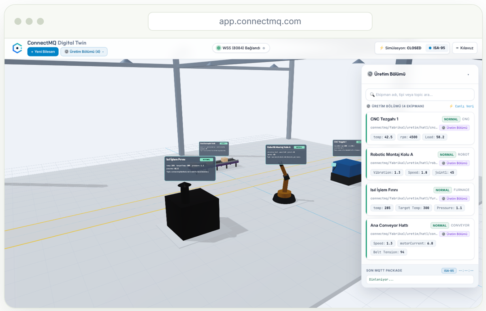

# ESP32 MQTT Example

[](https://connectmq.com/?utm_source=github&utm_medium=code-samples&utm_campaign=mqtt-code-samples&utm_content=esp32-badge)
[](https://connectmq.com/public-mqtt-broker/?utm_source=github&utm_medium=code-samples&utm_campaign=mqtt-code-samples&utm_content=esp32-badge)
[](../LICENSE)

Connect an ESP32 to an MQTT broker over Wi-Fi with the Arduino PubSubClient library. Start on the free public broker, then point the same code at a secure private broker on ConnectMQ.

> **Built for [ConnectMQ](https://connectmq.com/?utm_source=github&utm_medium=code-samples&utm_campaign=mqtt-code-samples&utm_content=esp32-intro)** — the managed, serverless MQTT broker for IoT. Try this example on the free public broker in seconds, then move the very same code to a secure private broker with a free ConnectMQ account. 👉 [Start for free](https://app.connectmq.com/signup?utm_source=github&utm_medium=code-samples&utm_campaign=mqtt-code-samples&utm_content=esp32-intro)

Full walkthrough on the website: **[ESP32 MQTT example](https://connectmq.com/code-samples/esp32/?utm_source=github&utm_medium=code-samples&utm_campaign=mqtt-code-samples&utm_content=esp32-intro)**

<p align="center"><a href="https://connectmq.com/?utm_source=github&utm_medium=code-samples&utm_campaign=mqtt-code-samples&utm_content=esp32-hero"></a></p>

## Requirements

- **Library:** [PubSubClient (Arduino)](https://github.com/knolleary/pubsubclient)
- **Install:**

```bash
arduino-cli lib install PubSubClient
```

## Files

| Folder | Broker | What it does |
| --- | --- | --- |
| [`public-broker/`](public-broker/) | Free public broker `broker.connectmq.com` | Connect without an account, subscribe and publish a JSON reading |
| [`private-broker/`](private-broker/) | Your private ConnectMQ broker | The same flow over TLS with your username and password |

## How to run

1. Install the **ESP32 board package** and the **PubSubClient** library (`arduino-cli lib install PubSubClient`, or the Library Manager of the Arduino IDE).
2. Open `esp32_mqtt.ino`, set `WIFI_SSID` and `WIFI_PASS`.
3. Select your ESP32 board, upload, and open the Serial Monitor at **115200 baud**.

---

## 1. Try it on the free public broker (no account needed)

No account needed: connect to broker.connectmq.com on port 1883 and start publishing in seconds.

| Protocol | URL |
| --- | --- |
| MQTT (TCP) | `mqtt://broker.connectmq.com:1883` |
| MQTT over TLS | `mqtts://broker.connectmq.com:8883` |
| WebSocket | `ws://broker.connectmq.com:8083/mqtt` |
| Secure WebSocket | `wss://broker.connectmq.com:8084/mqtt` |

**`esp32_mqtt.ino`** ([open file](public-broker/esp32_mqtt.ino))

```cpp
#include <WiFi.h>
#include <PubSubClient.h>

const char* WIFI_SSID = "YOUR_WIFI";
const char* WIFI_PASS = "YOUR_WIFI_PASSWORD";
const char* TOPIC = "your-project/sensors/temperature"; // Use a unique topic prefix: everyone can read the public broker

WiFiClient net;
PubSubClient mqtt(net);

// Runs for every message on a subscribed topic
void onMessage(char* topic, byte* payload, unsigned int length) {
  Serial.printf("%s: %.*s\n", topic, length, (char*)payload);
}

void connectMqtt() {
  while (!mqtt.connected()) {
    // Every client needs a unique client ID
    String id = "esp32-" + String((uint32_t)ESP.getEfuseMac(), HEX);
    if (mqtt.connect(id.c_str())) {
      // Subscribe to the temperature topic
      mqtt.subscribe(TOPIC);
    } else {
      delay(2000);
    }
  }
}

void setup() {
  Serial.begin(115200);
  // Connect to Wi-Fi first
  WiFi.begin(WIFI_SSID, WIFI_PASS);
  while (WiFi.status() != WL_CONNECTED) delay(500);
  // Connect to the free public broker (no account needed)
  mqtt.setServer("broker.connectmq.com", 1883);
  mqtt.setCallback(onMessage);
}

void loop() {
  // Reconnect automatically if the connection drops
  if (!mqtt.connected()) connectMqtt();
  mqtt.loop();
  static unsigned long last = 0;
  if (millis() - last > 10000) {
    last = millis();
    // Publish a JSON reading
    mqtt.publish(TOPIC, "{\"temperature\":21.5}");
  }
}
```

> ⚠️ **The public broker is shared:** anyone can subscribe to any topic, including yours. Never send passwords, personal data or anything confidential through it, and use a unique topic prefix (`your-project/...`) so your messages don't mix with others'. There is no guarantee of availability or message retention. [About the free public MQTT broker](https://connectmq.com/public-mqtt-broker/?utm_source=github&utm_medium=code-samples&utm_campaign=mqtt-code-samples&utm_content=esp32-public)

## 2. Go to production with a private ConnectMQ broker

For real devices, use a private serverless MQTT broker on ConnectMQ instead of the public one: TLS encryption, a username and password for every device and per-topic access control, fully managed. The Free plan needs no credit card.

**Get your private broker in under a minute:**

1. [Create a free ConnectMQ account](https://app.connectmq.com/signup?utm_source=github&utm_medium=code-samples&utm_campaign=mqtt-code-samples&utm_content=esp32-private) — no credit card.
2. Create a broker in the dashboard (the **Free** plan is enough to start).
3. Copy the **host**, **username** and **password** of your broker.
4. Replace `YOUR_BROKER_HOST`, `YOUR_USERNAME` and `YOUR_PASSWORD` in the files under [`private-broker/`](private-broker/) and run them.

**`esp32_mqtt.ino`** ([open file](private-broker/esp32_mqtt.ino))

```cpp
#include <WiFi.h>
#include <WiFiClientSecure.h>
#include <PubSubClient.h>

const char* WIFI_SSID = "YOUR_WIFI";
const char* WIFI_PASS = "YOUR_WIFI_PASSWORD";
const char* TOPIC = "your-project/sensors/temperature";

// Root CA certificate (PEM) of the broker TLS certificate
const char* ROOT_CA = R"PEM(
-----BEGIN CERTIFICATE-----
...
-----END CERTIFICATE-----
)PEM";

WiFiClientSecure net;
PubSubClient mqtt(net);

// Runs for every message on a subscribed topic
void onMessage(char* topic, byte* payload, unsigned int length) {
  Serial.printf("%s: %.*s\n", topic, length, (char*)payload);
}

void connectMqtt() {
  while (!mqtt.connected()) {
    // Every client needs a unique client ID
    String id = "esp32-" + String((uint32_t)ESP.getEfuseMac(), HEX);
    // Username and password from your ConnectMQ dashboard
    if (mqtt.connect(id.c_str(), "YOUR_USERNAME", "YOUR_PASSWORD")) {
      // Subscribe to the temperature topic
      mqtt.subscribe(TOPIC);
    } else {
      delay(2000);
    }
  }
}

void setup() {
  Serial.begin(115200);
  // Connect to Wi-Fi first
  WiFi.begin(WIFI_SSID, WIFI_PASS);
  while (WiFi.status() != WL_CONNECTED) delay(500);
  net.setCACert(ROOT_CA);
  // Connect to your private ConnectMQ broker on port 8883
  mqtt.setServer("YOUR_BROKER_HOST", 8883);
  mqtt.setCallback(onMessage);
}

void loop() {
  // Reconnect automatically if the connection drops
  if (!mqtt.connected()) connectMqtt();
  mqtt.loop();
  static unsigned long last = 0;
  if (millis() - last > 10000) {
    last = millis();
    // Publish a JSON reading
    mqtt.publish(TOPIC, "{\"temperature\":21.5}");
  }
}
```

> **TLS certificate:** paste the root CA certificate (PEM) of your broker into `ROOT_CA`. ConnectMQ broker certificates are issued by Let's Encrypt, so use **ISRG Root X1**: [isrgrootx1.pem](https://letsencrypt.org/certs/isrgrootx1.pem).

### What you get with a private broker

- 🔒 **TLS encryption** on every connection (port 8883, secure WebSocket 8084)
- 🔑 **A username and password per device**, created in the dashboard
- 🛡️ **Per-topic access control (ACL)** — decide which client may publish or subscribe to which topic
- 📊 **Devices & connections dashboard** — live device status, last values, connection history
- ⚡ **Fully managed and serverless** — no servers to patch or scale

<table>
  <tr>
    <td width="50%" valign="top"><a href="https://connectmq.com/monitoring/?utm_source=github&utm_medium=code-samples&utm_campaign=mqtt-code-samples&utm_content=esp32-gallery"></a><br><b>Live dashboard</b> — broker status, ISA-95 topic tree and a live card for every topic</td>
    <td width="50%" valign="top"><a href="https://connectmq.com/digital-twin/?utm_source=github&utm_medium=code-samples&utm_campaign=mqtt-code-samples&utm_content=esp32-gallery"></a><br><b>3D Digital Twin</b> — machines bound to their MQTT topics, telemetry on the equipment</td>
  </tr>
  <tr>
    <td width="50%" valign="top"><a href="https://connectmq.com/rules-alerts/?utm_source=github&utm_medium=code-samples&utm_campaign=mqtt-code-samples&utm_content=esp32-gallery"></a><br><b>Rules</b> — thresholds on JSON payload fields, such as <code>{temp} &gt; 70</code></td>
    <td width="50%" valign="top"><a href="https://connectmq.com/rules-alerts/?utm_source=github&utm_medium=code-samples&utm_campaign=mqtt-code-samples&utm_content=esp32-gallery"></a><br><b>Alerts</b> — audit log with the exact payload, plus browser notifications</td>
  </tr>
</table>

## Public vs. private broker

| | Free public broker | Private broker on ConnectMQ |
| --- | --- | --- |
| Account | Not needed | Free sign-up, no credit card |
| Host | `broker.connectmq.com` | Your own broker host |
| Who can read your topics | **Anyone** | Only your devices |
| Encryption | Optional (TLS on 8883) | TLS on every connection |
| Authentication | None | Username and password per device |
| Topic access control (ACL) | No | Yes, per topic and per client |
| Device & connection dashboard | No | Yes |
| Use it for | Learning, demos, quick tests | Real devices and production |

---

<p align="center">
  <a href="https://connectmq.com/?utm_source=github&utm_medium=code-samples&utm_campaign=mqtt-code-samples&utm_content=esp32-footer"><b>ConnectMQ</b></a> — managed MQTT broker for IoT ·
  <a href="https://app.connectmq.com/signup?utm_source=github&utm_medium=code-samples&utm_campaign=mqtt-code-samples&utm_content=esp32-footer">Start for free</a> ·
  <a href="https://connectmq.com/pricing/?utm_source=github&utm_medium=code-samples&utm_campaign=mqtt-code-samples&utm_content=esp32-footer">Pricing</a> ·
  <a href="https://connectmq.com/code-samples/?utm_source=github&utm_medium=code-samples&utm_campaign=mqtt-code-samples&utm_content=esp32-footer">All code samples</a>
</p>
