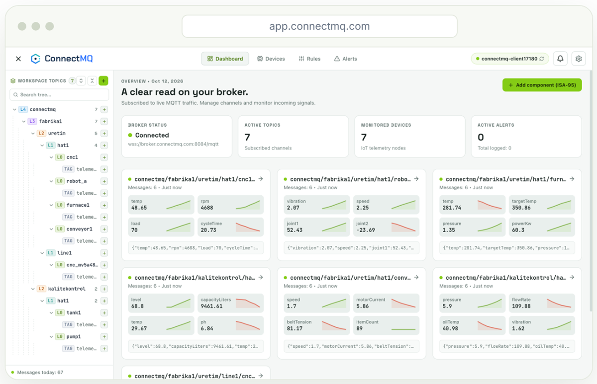

# MQTT Tutorials by ConnectMQ

The complete code of **58 step-by-step tutorials** from the [ConnectMQ blog](https://connectmq.com/blog/category/iot-tutorials/?utm_source=github&utm_medium=code-samples&utm_campaign=mqtt-code-samples&utm_content=tutorials-intro) — real projects, not just "hello world": store MQTT data in databases, build dashboards, mobile and desktop apps, bots, device simulators, secure TLS clients and resilient reconnect logic.

Every tutorial runs on the **free public broker `broker.connectmq.com`** with no account, and its README shows exactly what to change to run it on your **private ConnectMQ broker** — TLS, a username and password per device and per-topic access control.

> **[ConnectMQ](https://connectmq.com/?utm_source=github&utm_medium=code-samples&utm_campaign=mqtt-code-samples&utm_content=tutorials-intro)** is a managed, serverless MQTT broker for IoT. Start on the **Free** plan — no credit card. 👉 **[Create your free broker](https://app.connectmq.com/signup?utm_source=github&utm_medium=code-samples&utm_campaign=mqtt-code-samples&utm_content=tutorials-intro)**

## Contents

- [Python](#-python) (16)
- [Databases & time series](#-databases--time-series) (4)
- [Grafana, Telegraf & the TIG stack](#-grafana-telegraf--the-tig-stack) (5)
- [JavaScript, TypeScript & web apps](#-javascript-typescript--web-apps) (9)
- [Mobile, desktop & 3D apps](#-mobile-desktop--3d-apps) (7)
- [Backend languages](#-backend-languages) (9)
- [Embedded devices](#-embedded-devices) (2)
- [Tools, CLI & testing](#-tools-cli--testing) (6)

## 🐍 Python

| Tutorial | Stack | Code | Full guide |
| --- | --- | --- | --- |
| **[Paho MQTT Python Tutorial: Publish and Subscribe in 10 Minutes](paho-mqtt-python/)** | Python | [`paho-mqtt-python/`](paho-mqtt-python/) | [Read on connectmq.com](https://connectmq.com/blog/paho-mqtt-python/?utm_source=github&utm_medium=code-samples&utm_campaign=mqtt-code-samples&utm_content=tutorials-paho-mqtt-python) |
| **[Paho MQTT 2.0 Callback API Version: Fixing Migration Errors Step by Step](paho-mqtt-2-0-callback-api-version/)** | Python | [`paho-mqtt-2-0-callback-api-version/`](paho-mqtt-2-0-callback-api-version/) | [Read on connectmq.com](https://connectmq.com/blog/paho-mqtt-2-0-callback-api-version/?utm_source=github&utm_medium=code-samples&utm_campaign=mqtt-code-samples&utm_content=tutorials-paho-mqtt-2-0-callback-api-version) |
| **[Paho MQTT Reconnect: Robust Backoff, Resubscribe and Offline Buffering in Python](paho-mqtt-reconnect/)** | Python | [`paho-mqtt-reconnect/`](paho-mqtt-reconnect/) | [Read on connectmq.com](https://connectmq.com/blog/paho-mqtt-reconnect/?utm_source=github&utm_medium=code-samples&utm_campaign=mqtt-code-samples&utm_content=tutorials-paho-mqtt-reconnect) |
| **[Python MQTT JSON: Publishing Sensor Data with Timestamps and Schema Versions](python-mqtt-json/)** | Python | [`python-mqtt-json/`](python-mqtt-json/) | [Read on connectmq.com](https://connectmq.com/blog/python-mqtt-json/?utm_source=github&utm_medium=code-samples&utm_campaign=mqtt-code-samples&utm_content=tutorials-python-mqtt-json) |
| **[Python MQTT TLS: Connecting Securely on Port 8883 with paho-mqtt](python-mqtt-tls/)** | Python | [`python-mqtt-tls/`](python-mqtt-tls/) | [Read on connectmq.com](https://connectmq.com/blog/python-mqtt-tls/?utm_source=github&utm_medium=code-samples&utm_campaign=mqtt-code-samples&utm_content=tutorials-python-mqtt-tls) |
| **[Async MQTT in Python with aiomqtt and asyncio: Tasks, Workers and Reconnects](aiomqtt-asyncio/)** | Python | [`aiomqtt-asyncio/`](aiomqtt-asyncio/) | [Read on connectmq.com](https://connectmq.com/blog/aiomqtt-asyncio/?utm_source=github&utm_medium=code-samples&utm_campaign=mqtt-code-samples&utm_content=tutorials-aiomqtt-asyncio) |
| **[Build an MQTT Device Simulator in Python for Hundreds of Virtual Sensors](mqtt-device-simulator/)** | Python | [`mqtt-device-simulator/`](mqtt-device-simulator/) | [Read on connectmq.com](https://connectmq.com/blog/mqtt-device-simulator/?utm_source=github&utm_medium=code-samples&utm_campaign=mqtt-code-samples&utm_content=tutorials-mqtt-device-simulator) |
| **[Log MQTT Messages to CSV with Python for Quick Analysis](log-mqtt-messages-to-csv/)** | Python | [`log-mqtt-messages-to-csv/`](log-mqtt-messages-to-csv/) | [Read on connectmq.com](https://connectmq.com/blog/log-mqtt-messages-to-csv/?utm_source=github&utm_medium=code-samples&utm_campaign=mqtt-code-samples&utm_content=tutorials-log-mqtt-messages-to-csv) |
| **[Real-Time MQTT Data Analysis with Python and pandas](mqtt-pandas/)** | Python | [`mqtt-pandas/`](mqtt-pandas/) | [Read on connectmq.com](https://connectmq.com/blog/mqtt-pandas/?utm_source=github&utm_medium=code-samples&utm_campaign=mqtt-code-samples&utm_content=tutorials-mqtt-pandas) |
| **[Exploring MQTT Data in a Jupyter Notebook: Subscribe, Plot and Save Snapshots](mqtt-jupyter-notebook/)** | Python (Jupyter) | [`mqtt-jupyter-notebook/`](mqtt-jupyter-notebook/) | [Read on connectmq.com](https://connectmq.com/blog/mqtt-jupyter-notebook/?utm_source=github&utm_medium=code-samples&utm_campaign=mqtt-code-samples&utm_content=tutorials-mqtt-jupyter-notebook) |
| **[Streamlit MQTT Dashboard in Pure Python: Live Sensor Charts in 100 Lines](streamlit-mqtt-dashboard/)** | Python (Streamlit) | [`streamlit-mqtt-dashboard/`](streamlit-mqtt-dashboard/) | [Read on connectmq.com](https://connectmq.com/blog/streamlit-mqtt-dashboard/?utm_source=github&utm_medium=code-samples&utm_campaign=mqtt-code-samples&utm_content=tutorials-streamlit-mqtt-dashboard) |
| **[MQTT to REST API Flask Tutorial: Expose Live Device Data over HTTP](mqtt-to-rest-api-flask/)** | Python (Flask) | [`mqtt-to-rest-api-flask/`](mqtt-to-rest-api-flask/) | [Read on connectmq.com](https://connectmq.com/blog/mqtt-to-rest-api-flask/?utm_source=github&utm_medium=code-samples&utm_campaign=mqtt-code-samples&utm_content=tutorials-mqtt-to-rest-api-flask) |
| **[MQTT Email Alerts Python Tutorial: Rate-Limited SMTP Notifications](mqtt-email-alerts-python/)** | Python | [`mqtt-email-alerts-python/`](mqtt-email-alerts-python/) | [Read on connectmq.com](https://connectmq.com/blog/mqtt-email-alerts-python/?utm_source=github&utm_medium=code-samples&utm_campaign=mqtt-code-samples&utm_content=tutorials-mqtt-email-alerts-python) |
| **[Build an MQTT Telegram Bot for Device Alerts and Commands](mqtt-telegram-bot/)** | Python | [`mqtt-telegram-bot/`](mqtt-telegram-bot/) | [Read on connectmq.com](https://connectmq.com/blog/mqtt-telegram-bot/?utm_source=github&utm_medium=code-samples&utm_campaign=mqtt-code-samples&utm_content=tutorials-mqtt-telegram-bot) |
| **[MQTT to Google Sheets: Send Sensor Data with Python and the Sheets API](mqtt-to-google-sheets/)** | Python | [`mqtt-to-google-sheets/`](mqtt-to-google-sheets/) | [Read on connectmq.com](https://connectmq.com/blog/mqtt-to-google-sheets/?utm_source=github&utm_medium=code-samples&utm_campaign=mqtt-code-samples&utm_content=tutorials-mqtt-to-google-sheets) |
| **[Testing MQTT Clients: Unit, Integration and End-to-End Tests](testing-mqtt-clients/)** | Python (pytest) | [`testing-mqtt-clients/`](testing-mqtt-clients/) | [Read on connectmq.com](https://connectmq.com/blog/testing-mqtt-clients/?utm_source=github&utm_medium=code-samples&utm_campaign=mqtt-code-samples&utm_content=tutorials-testing-mqtt-clients) |

## 🗄️ Databases & time series

| Tutorial | Stack | Code | Full guide |
| --- | --- | --- | --- |
| **[MQTT to SQLite with Python: Store and Query Sensor Messages](mqtt-to-sqlite-python/)** | Python | [`mqtt-to-sqlite-python/`](mqtt-to-sqlite-python/) | [Read on connectmq.com](https://connectmq.com/blog/mqtt-to-sqlite-python/?utm_source=github&utm_medium=code-samples&utm_campaign=mqtt-code-samples&utm_content=tutorials-mqtt-to-sqlite-python) |
| **[MQTT to TimescaleDB: Storing IoT Time Series in PostgreSQL](mqtt-to-timescaledb/)** | Python, PostgreSQL/TimescaleDB | [`mqtt-to-timescaledb/`](mqtt-to-timescaledb/) | [Read on connectmq.com](https://connectmq.com/blog/mqtt-to-timescaledb/?utm_source=github&utm_medium=code-samples&utm_campaign=mqtt-code-samples&utm_content=tutorials-mqtt-to-timescaledb) |
| **[How to Store MQTT Data in InfluxDB with Python](store-mqtt-data-in-influxdb/)** | Python | [`store-mqtt-data-in-influxdb/`](store-mqtt-data-in-influxdb/) | [Read on connectmq.com](https://connectmq.com/blog/store-mqtt-data-in-influxdb/?utm_source=github&utm_medium=code-samples&utm_campaign=mqtt-code-samples&utm_content=tutorials-store-mqtt-data-in-influxdb) |
| **[MQTT to MongoDB: Save Device Messages with Node.js and Time-Series Collections](mqtt-to-mongodb/)** | Node.js | [`mqtt-to-mongodb/`](mqtt-to-mongodb/) | [Read on connectmq.com](https://connectmq.com/blog/mqtt-to-mongodb/?utm_source=github&utm_medium=code-samples&utm_campaign=mqtt-code-samples&utm_content=tutorials-mqtt-to-mongodb) |

## 📈 Grafana, Telegraf & the TIG stack

| Tutorial | Stack | Code | Full guide |
| --- | --- | --- | --- |
| **[TIG Stack with Docker Compose for MQTT Data](tig-stack-docker-compose/)** | Docker | [`tig-stack-docker-compose/`](tig-stack-docker-compose/) | [Read on connectmq.com](https://connectmq.com/blog/tig-stack-docker-compose/?utm_source=github&utm_medium=code-samples&utm_campaign=mqtt-code-samples&utm_content=tutorials-tig-stack-docker-compose) |
| **[Telegraf MQTT Consumer: Ingest MQTT Data into InfluxDB](telegraf-mqtt-consumer/)** | Telegraf / InfluxDB | [`telegraf-mqtt-consumer/`](telegraf-mqtt-consumer/) | [Read on connectmq.com](https://connectmq.com/blog/telegraf-mqtt-consumer/?utm_source=github&utm_medium=code-samples&utm_campaign=mqtt-code-samples&utm_content=tutorials-telegraf-mqtt-consumer) |
| **[Telegraf json_v2 Parser and MQTT Topic Parsing Explained](telegraf-json-v2-parser/)** | Telegraf | [`telegraf-json-v2-parser/`](telegraf-json-v2-parser/) | [Read on connectmq.com](https://connectmq.com/blog/telegraf-json-v2-parser/?utm_source=github&utm_medium=code-samples&utm_campaign=mqtt-code-samples&utm_content=tutorials-telegraf-json-v2-parser) |
| **[Grafana MQTT Datasource: Live Streaming Panels from Your Broker](grafana-mqtt-datasource/)** | Docker / Grafana | [`grafana-mqtt-datasource/`](grafana-mqtt-datasource/) | [Read on connectmq.com](https://connectmq.com/blog/grafana-mqtt-datasource/?utm_source=github&utm_medium=code-samples&utm_campaign=mqtt-code-samples&utm_content=tutorials-grafana-mqtt-datasource) |
| **[Grafana Alerts for IoT Sensor Data: Thresholds, Stale Sensors and Notifications](grafana-alerts-iot-sensor-data/)** | Grafana / InfluxDB (Flux) | [`grafana-alerts-iot-sensor-data/`](grafana-alerts-iot-sensor-data/) | [Read on connectmq.com](https://connectmq.com/blog/grafana-alerts-iot-sensor-data/?utm_source=github&utm_medium=code-samples&utm_campaign=mqtt-code-samples&utm_content=tutorials-grafana-alerts-iot-sensor-data) |

## 🌐 JavaScript, TypeScript & web apps

| Tutorial | Stack | Code | Full guide |
| --- | --- | --- | --- |
| **[MQTT.js Node.js Tutorial: Publish, Subscribe, QoS and TLS](mqtt-js-node-js/)** | Node.js | [`mqtt-js-node-js/`](mqtt-js-node-js/) | [Read on connectmq.com](https://connectmq.com/blog/mqtt-js-node-js/?utm_source=github&utm_medium=code-samples&utm_campaign=mqtt-code-samples&utm_content=tutorials-mqtt-js-node-js) |
| **[Type-Safe MQTT TypeScript Client: Typed Topics and Validated Payloads](mqtt-typescript/)** | TypeScript, Node.js | [`mqtt-typescript/`](mqtt-typescript/) | [Read on connectmq.com](https://connectmq.com/blog/mqtt-typescript/?utm_source=github&utm_medium=code-samples&utm_campaign=mqtt-code-samples&utm_content=tutorials-mqtt-typescript) |
| **[MQTT in the Browser with JavaScript: A Minimal Client in One HTML Page](mqtt-javascript-browser/)** | HTML/JavaScript (MQTT.js, browser) | [`mqtt-javascript-browser/`](mqtt-javascript-browser/) | [Read on connectmq.com](https://connectmq.com/blog/mqtt-javascript-browser/?utm_source=github&utm_medium=code-samples&utm_campaign=mqtt-code-samples&utm_content=tutorials-mqtt-javascript-browser) |
| **[MQTT over WebSocket: Connect a Browser to an MQTT Broker with MQTT.js](mqtt-over-websocket/)** | JavaScript (browser + Node.js) | [`mqtt-over-websocket/`](mqtt-over-websocket/) | [Read on connectmq.com](https://connectmq.com/blog/mqtt-over-websocket/?utm_source=github&utm_medium=code-samples&utm_campaign=mqtt-code-samples&utm_content=tutorials-mqtt-over-websocket) |
| **[Build a Real-Time MQTT Chat App with JavaScript, Presence and No Local](mqtt-chat-app/)** | JavaScript (browser, MQTT.js) | [`mqtt-chat-app/`](mqtt-chat-app/) | [Read on connectmq.com](https://connectmq.com/blog/mqtt-chat-app/?utm_source=github&utm_medium=code-samples&utm_campaign=mqtt-code-samples&utm_content=tutorials-mqtt-chat-app) |
| **[React MQTT Tutorial: A Hooks-Based Real-Time Dashboard](react-mqtt/)** | React (JavaScript) | [`react-mqtt/`](react-mqtt/) | [Read on connectmq.com](https://connectmq.com/blog/react-mqtt/?utm_source=github&utm_medium=code-samples&utm_campaign=mqtt-code-samples&utm_content=tutorials-react-mqtt) |
| **[Vue MQTT Client: Real-Time Data over WebSocket with Vue 3](vue-mqtt/)** | Vue 3 (JavaScript, MQTT.js) | [`vue-mqtt/`](vue-mqtt/) | [Read on connectmq.com](https://connectmq.com/blog/vue-mqtt/?utm_source=github&utm_medium=code-samples&utm_campaign=mqtt-code-samples&utm_content=tutorials-vue-mqtt) |
| **[Angular MQTT Tutorial with RxJS, MQTT.js and ngx-mqtt](angular-mqtt/)** | TypeScript (Angular) | [`angular-mqtt/`](angular-mqtt/) | [Read on connectmq.com](https://connectmq.com/blog/angular-mqtt/?utm_source=github&utm_medium=code-samples&utm_campaign=mqtt-code-samples&utm_content=tutorials-angular-mqtt) |
| **[Next.js MQTT: Server and Client Integration Patterns That Actually Work](next-js-mqtt/)** | Next.js, JavaScript | [`next-js-mqtt/`](next-js-mqtt/) | [Read on connectmq.com](https://connectmq.com/blog/next-js-mqtt/?utm_source=github&utm_medium=code-samples&utm_campaign=mqtt-code-samples&utm_content=tutorials-next-js-mqtt) |

## 📱 Mobile, desktop & 3D apps

| Tutorial | Stack | Code | Full guide |
| --- | --- | --- | --- |
| **[Android MQTT Kotlin Client: Connect, Subscribe and Notify](android-mqtt-kotlin/)** | Kotlin (Android) | [`android-mqtt-kotlin/`](android-mqtt-kotlin/) | [Read on connectmq.com](https://connectmq.com/blog/android-mqtt-kotlin/?utm_source=github&utm_medium=code-samples&utm_campaign=mqtt-code-samples&utm_content=tutorials-android-mqtt-kotlin) |
| **[iOS MQTT Swift Client with CocoaMQTT and SwiftUI](ios-mqtt-swift/)** | Swift (SwiftUI, CocoaMQTT) | [`ios-mqtt-swift/`](ios-mqtt-swift/) | [Read on connectmq.com](https://connectmq.com/blog/ios-mqtt-swift/?utm_source=github&utm_medium=code-samples&utm_campaign=mqtt-code-samples&utm_content=tutorials-ios-mqtt-swift) |
| **[Flutter MQTT Client: Building a Cross-Platform IoT App](flutter-mqtt/)** | Dart (Flutter) | [`flutter-mqtt/`](flutter-mqtt/) | [Read on connectmq.com](https://connectmq.com/blog/flutter-mqtt/?utm_source=github&utm_medium=code-samples&utm_campaign=mqtt-code-samples&utm_content=tutorials-flutter-mqtt) |
| **[React Native MQTT: Real-Time Mobile IoT Apps over WebSocket](react-native-mqtt/)** | React Native (JavaScript) | [`react-native-mqtt/`](react-native-mqtt/) | [Read on connectmq.com](https://connectmq.com/blog/react-native-mqtt/?utm_source=github&utm_medium=code-samples&utm_campaign=mqtt-code-samples&utm_content=tutorials-react-native-mqtt) |
| **[.NET MAUI MQTT App: Monitor and Control Devices on Android, iOS and Windows](net-maui-mqtt/)** | C#, .NET MAUI | [`net-maui-mqtt/`](net-maui-mqtt/) | [Read on connectmq.com](https://connectmq.com/blog/net-maui-mqtt/?utm_source=github&utm_medium=code-samples&utm_campaign=mqtt-code-samples&utm_content=tutorials-net-maui-mqtt) |
| **[Qt MQTT Client in C++: Building Desktop and Embedded HMIs](qt-mqtt-client/)** | C++ (Qt 6) | [`qt-mqtt-client/`](qt-mqtt-client/) | [Read on connectmq.com](https://connectmq.com/blog/qt-mqtt-client/?utm_source=github&utm_medium=code-samples&utm_campaign=mqtt-code-samples&utm_content=tutorials-qt-mqtt-client) |
| **[Unity MQTT Client: Drive 3D Scenes with Live Sensor Data](unity-mqtt-client/)** | C# (Unity, MQTTnet) | [`unity-mqtt-client/`](unity-mqtt-client/) | [Read on connectmq.com](https://connectmq.com/blog/unity-mqtt-client/?utm_source=github&utm_medium=code-samples&utm_campaign=mqtt-code-samples&utm_content=tutorials-unity-mqtt-client) |

## 🧱 Backend languages

| Tutorial | Stack | Code | Full guide |
| --- | --- | --- | --- |
| **[MQTTnet C# Tutorial: Build MQTT 5 Clients in .NET with TLS](mqttnet/)** | C# | [`mqttnet/`](mqttnet/) | [Read on connectmq.com](https://connectmq.com/blog/mqttnet/?utm_source=github&utm_medium=code-samples&utm_campaign=mqtt-code-samples&utm_content=tutorials-mqttnet) |
| **[ASP.NET Core MQTT: A Background Service That Stores and Streams Device Data](asp-net-core-mqtt/)** | C# (ASP.NET Core) | [`asp-net-core-mqtt/`](asp-net-core-mqtt/) | [Read on connectmq.com](https://connectmq.com/blog/asp-net-core-mqtt/?utm_source=github&utm_medium=code-samples&utm_campaign=mqtt-code-samples&utm_content=tutorials-asp-net-core-mqtt) |
| **[Java MQTT Client Tutorial: Eclipse Paho vs HiveMQ Client with TLS and MQTT 5](java-mqtt-client/)** | Java | [`java-mqtt-client/`](java-mqtt-client/) | [Read on connectmq.com](https://connectmq.com/blog/java-mqtt-client/?utm_source=github&utm_medium=code-samples&utm_campaign=mqtt-code-samples&utm_content=tutorials-java-mqtt-client) |
| **[Spring Boot MQTT Integration: Consume Device Data and Expose It via REST](spring-boot-mqtt/)** | Java (Spring Boot) | [`spring-boot-mqtt/`](spring-boot-mqtt/) | [Read on connectmq.com](https://connectmq.com/blog/spring-boot-mqtt/?utm_source=github&utm_medium=code-samples&utm_campaign=mqtt-code-samples&utm_content=tutorials-spring-boot-mqtt) |
| **[Go MQTT Client Tutorial with Eclipse Paho autopaho and MQTT 5](go-mqtt-client/)** | Go | [`go-mqtt-client/`](go-mqtt-client/) | [Read on connectmq.com](https://connectmq.com/blog/go-mqtt-client/?utm_source=github&utm_medium=code-samples&utm_campaign=mqtt-code-samples&utm_content=tutorials-go-mqtt-client) |
| **[Rust MQTT with rumqttc: Async Publish/Subscribe over TLS with Tokio](rust-mqtt-rumqttc/)** | Rust | [`rust-mqtt-rumqttc/`](rust-mqtt-rumqttc/) | [Read on connectmq.com](https://connectmq.com/blog/rust-mqtt-rumqttc/?utm_source=github&utm_medium=code-samples&utm_campaign=mqtt-code-samples&utm_content=tutorials-rust-mqtt-rumqttc) |
| **[PHP MQTT Client Tutorial with php-mqtt/client](php-mqtt-client/)** | PHP | [`php-mqtt-client/`](php-mqtt-client/) | [Read on connectmq.com](https://connectmq.com/blog/php-mqtt-client/?utm_source=github&utm_medium=code-samples&utm_campaign=mqtt-code-samples&utm_content=tutorials-php-mqtt-client) |
| **[Ruby MQTT Client Tutorial: Publish, Subscribe and TLS with the mqtt Gem](ruby-mqtt-client/)** | Ruby | [`ruby-mqtt-client/`](ruby-mqtt-client/) | [Read on connectmq.com](https://connectmq.com/blog/ruby-mqtt-client/?utm_source=github&utm_medium=code-samples&utm_campaign=mqtt-code-samples&utm_content=tutorials-ruby-mqtt-client) |
| **[MQTT Client Libraries: Choosing the Right One for Every Language](mqtt-client-libraries/)** | Multi-language (Python, Node.js, Go, Java, C#, Rust, C) | [`mqtt-client-libraries/`](mqtt-client-libraries/) | [Read on connectmq.com](https://connectmq.com/blog/mqtt-client-libraries/?utm_source=github&utm_medium=code-samples&utm_campaign=mqtt-code-samples&utm_content=tutorials-mqtt-client-libraries) |

## 🔌 Embedded devices

| Tutorial | Stack | Code | Full guide |
| --- | --- | --- | --- |
| **[ESP32 MQTT Tutorial: Publish Sensor Data and Control an LED with Arduino IDE](esp32-mqtt-tutorial/)** | Arduino C++ (ESP32) | [`esp32-mqtt-tutorial/`](esp32-mqtt-tutorial/) | [Read on connectmq.com](https://connectmq.com/blog/esp32-mqtt-tutorial/?utm_source=github&utm_medium=code-samples&utm_campaign=mqtt-code-samples&utm_content=tutorials-esp32-mqtt-tutorial) |
| **[Paho MQTT C Client Tutorial for Embedded Linux](paho-mqtt-c/)** | C | [`paho-mqtt-c/`](paho-mqtt-c/) | [Read on connectmq.com](https://connectmq.com/blog/paho-mqtt-c/?utm_source=github&utm_medium=code-samples&utm_campaign=mqtt-code-samples&utm_content=tutorials-paho-mqtt-c) |

## 🛠️ Tools, CLI & testing

| Tutorial | Stack | Code | Full guide |
| --- | --- | --- | --- |
| **[Free Public MQTT Broker for Testing: Connect to broker.connectmq.com in Minutes](free-public-mqtt-broker/)** | CLI, Python, Node.js | [`free-public-mqtt-broker/`](free-public-mqtt-broker/) | [Read on connectmq.com](https://connectmq.com/blog/free-public-mqtt-broker/?utm_source=github&utm_medium=code-samples&utm_campaign=mqtt-code-samples&utm_content=tutorials-free-public-mqtt-broker) |
| **[mosquitto_pub mosquitto_sub Examples: 25 Practical Commands for MQTT Testing](mosquitto-pub-mosquitto-sub-examples/)** | CLI (Mosquitto) | [`mosquitto-pub-mosquitto-sub-examples/`](mosquitto-pub-mosquitto-sub-examples/) | [Read on connectmq.com](https://connectmq.com/blog/mosquitto-pub-mosquitto-sub-examples/?utm_source=github&utm_medium=code-samples&utm_campaign=mqtt-code-samples&utm_content=tutorials-mosquitto-pub-mosquitto-sub-examples) |
| **[Best MQTT CLI Tools for Testing, Scripting and Debugging](mqtt-cli-tools/)** | CLI | [`mqtt-cli-tools/`](mqtt-cli-tools/) | [Read on connectmq.com](https://connectmq.com/blog/mqtt-cli-tools/?utm_source=github&utm_medium=code-samples&utm_campaign=mqtt-code-samples&utm_content=tutorials-mqtt-cli-tools) |
| **[MQTT Explorer Desktop App Comparison: Visualizing Topic Trees](mqtt-explorer-desktop-app/)** | CLI (Mosquitto) / desktop GUI tools | [`mqtt-explorer-desktop-app/`](mqtt-explorer-desktop-app/) | [Read on connectmq.com](https://connectmq.com/blog/mqtt-explorer-desktop-app/?utm_source=github&utm_medium=code-samples&utm_campaign=mqtt-code-samples&utm_content=tutorials-mqtt-explorer-desktop-app) |
| **[VS Code MQTT Extension: Publish and Subscribe Without Leaving Your Editor](vs-code-mqtt-extension/)** | VS Code / Mosquitto CLI | [`vs-code-mqtt-extension/`](vs-code-mqtt-extension/) | [Read on connectmq.com](https://connectmq.com/blog/vs-code-mqtt-extension/?utm_source=github&utm_medium=code-samples&utm_campaign=mqtt-code-samples&utm_content=tutorials-vs-code-mqtt-extension) |
| **[MQTT Load Testing Tools: emqtt-bench, MQTTX Bench and Locust Compared](mqtt-load-testing-tools/)** | Python / CLI | [`mqtt-load-testing-tools/`](mqtt-load-testing-tools/) | [Read on connectmq.com](https://connectmq.com/blog/mqtt-load-testing-tools/?utm_source=github&utm_medium=code-samples&utm_campaign=mqtt-code-samples&utm_content=tutorials-mqtt-load-testing-tools) |

## How every tutorial works

1. **Start on the free public broker** — the code connects to `broker.connectmq.com` (ports 1883 / 8883 / 8083 / 8084) without an account. Use a unique topic prefix: the public broker is shared.
2. **Move to your private ConnectMQ broker** — [sign up for free](https://app.connectmq.com/signup?utm_source=github&utm_medium=code-samples&utm_campaign=mqtt-code-samples&utm_content=tutorials-how), create a broker, copy its host, username and password, and apply the change shown in the tutorial's README.

<table>
  <tr>
    <td width="50%" valign="top"> <b>Live dashboard</b> — see the data your tutorial publishes, topic by topic</td>
    <td width="50%" valign="top"> <b>Rules & alerts</b> — thresholds on payload fields, audit log and notifications</td>
  </tr>
</table>

## More

- 🧩 [Basic examples in 12 languages](../) — connect, subscribe and publish in a few lines
- ✍️ [ConnectMQ blog](https://connectmq.com/blog/?utm_source=github&utm_medium=code-samples&utm_campaign=mqtt-code-samples&utm_content=tutorials-more) — MQTT fundamentals, IoT architecture, industrial IoT and more
- 🌍 [Free public MQTT broker](https://connectmq.com/public-mqtt-broker/?utm_source=github&utm_medium=code-samples&utm_campaign=mqtt-code-samples&utm_content=tutorials-more)

---

  <a href="https://connectmq.com/?utm_source=github&utm_medium=code-samples&utm_campaign=mqtt-code-samples&utm_content=tutorials-footer"><b>ConnectMQ</b></a> — managed MQTT broker for IoT ·
  <a href="https://app.connectmq.com/signup?utm_source=github&utm_medium=code-samples&utm_campaign=mqtt-code-samples&utm_content=tutorials-footer">Start for free</a> ·
  <a href="https://connectmq.com/pricing/?utm_source=github&utm_medium=code-samples&utm_campaign=mqtt-code-samples&utm_content=tutorials-footer">Pricing</a> ·
  <a href="https://connectmq.com/blog/?utm_source=github&utm_medium=code-samples&utm_campaign=mqtt-code-samples&utm_content=tutorials-footer">Blog</a>

